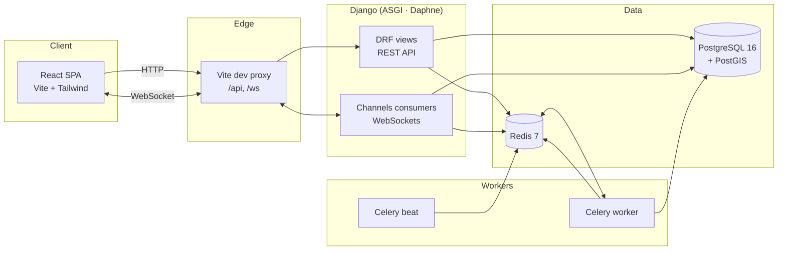

# SwiftBite 🍔

A full-stack food-delivery platform: customers browse restaurants and order, vendors
accept and prepare orders, and drivers claim, pick up and deliver them — with **live
order tracking, in-app chat and push notifications** over WebSockets.

The system is split into two repositories: this one (Django API, realtime layer,
background workers and deployment) and the React web client. Both are documented below.


---

## Table of contents

- [Features](#features)
- [Architecture](#architecture)
- [Tech stack](#tech-stack)
- [Repository layout](#repository-layout)
- [Quick start — Docker](#quick-start--docker)
- [Quick start — local development](#quick-start--local-development)
  - [Backend](#backend)
  - [Frontend](#frontend)
- [Configuration](#configuration)
- [Seeded accounts and data](#seeded-accounts-and-data)
- [API reference](#api-reference)
- [Realtime API](#realtime-api)
- [Order lifecycle](#order-lifecycle)
- [Background jobs](#background-jobs)
- [Payments](#payments)
- [Testing](#testing)
- [Troubleshooting](#troubleshooting)
- [Project documentation](#project-documentation)
- [Contributing](#contributing)
- [Known limitations and roadmap](#known-limitations-and-roadmap)
- [License](#license)

---

## Features

### Customers

- Browse restaurants with distance filtering (`?lat=&lng=&radius=`) and open restaurant pages with menus.
- Add items to a cart, adjust quantities, and check out with a delivery address and a map-picked location.
- Follow an order live: a status timeline plus a live driver map.
- Cancel an order while it is still `PENDING`.
- Chat with the vendor and driver in the order conversation.
- Notification bell with unread counts for order and chat events.

### Vendors

- Manage owned restaurants and their menu items (create, update, delete; prices and availability).
- Receive new-order alerts in real time.
- Move orders through `ACCEPTED → PREPARING → READY`.
- See all orders for their restaurants, including customer and driver details.

### Drivers

- See available `READY` orders and claim one (this also opens the order chat).
- Mark orders `PICKED_UP` and `DELIVERED`.
- Broadcast live GPS location to the customer's tracking map.
- Toggle availability and set a base location from the profile page.

### Platform

- JWT authentication (SimpleJWT) with short-lived access tokens and automatic token refresh on the client.
- Role-based access control: `CUSTOMER`, `VENDOR`, `DRIVER`, `ADMIN`.
- WebSocket push for order status, driver location, chat messages and notifications.
- Celery background tasks for notification fan-out and stale-cart maintenance.
- OpenAPI schema + Swagger UI generated with `drf-spectacular`.
- Non-sequential, keyed order codes (`FD-…`) so database ids are never exposed to users.
- Seed commands for a realistic local dataset.

<!-- Screenshots: add images to a docs/screenshots/ folder and embed them here. -->

---

## Architecture



### Request path

1. The React client calls `/api/...` with `Authorization: Bearer <access>`.
2. Daphne serves the ASGI application; `config/routing.py` routes HTTP to Django and
   WebSocket upgrades to Channels consumers.
3. DRF views validate, apply role/ownership checks, persist to PostgreSQL and publish
   realtime events to Redis.

### Realtime path

1. A REST action (checkout, status change, message, claim) commits to PostgreSQL.
2. A Celery task creates `Notification` rows; `config/events.py:publish_group` sends a
   payload to a Redis channel-layer group (best-effort — a Redis outage never breaks
   checkout).
3. Every Daphne process subscribed to that group pushes the JSON payload down the
   matching WebSocket.

### Why three data stores

| Store | Role | Source of truth? |
| --- | --- | --- |
| PostgreSQL + PostGIS | Users, restaurants, menus, carts, orders, payments, chat history, notifications; geospatial distance queries | **Yes** |
| Redis | Channel layer (WebSocket fan-out), Celery broker + result backend | No — pub/sub is at-most-once |
| Celery / beat | Background notification writes and hourly cart refresh | No — workers are stateless |

Because Redis pub/sub is not durable, clients re-read history from PostgreSQL on load;
WebSocket events only carry the live delta.

---

## Tech stack

| Layer | Technology | Purpose |
| --- | --- | --- |
| API | Django 5, Django REST Framework 3.15 | Models, views, serializers, permissions |
| Realtime | Django Channels 4, Daphne, channels-redis | ASGI server and WebSocket consumers |
| Auth | djangorestframework-simplejwt | JWT access/refresh tokens |
| Database | PostgreSQL 16 + PostGIS 3.4 | Relational data and geography columns |
| Async jobs | Celery 5 + Redis | Notification fan-out, scheduled cart refresh |
| API docs | drf-spectacular | OpenAPI 3 schema and Swagger UI |
| Web client | React 19, Vite 7, Tailwind CSS 4, React Router 7 | SPA with role-based routes |
| Maps | Leaflet + react-leaflet, OpenStreetMap tiles, Nominatim reverse geocoding | Location picking and live delivery map |
| HTTP client | Axios (with refresh-token interceptor) | API calls and token rotation |
| Packaging | uv (`pyproject.toml` + `uv.lock`) | Reproducible Python environment |
| Deployment | Docker, Docker Compose | db, redis, backend, celery |

---

## Repository layout

```text
.
├── backend/                  # Django project (this repository)
│   ├── accounts/             # Custom User model, roles, JWT register/login/me
│   ├── restaurants/          # Restaurant and MenuItem models, CRUD, distance filter
│   ├── orders/               # Cart, checkout, order state machine, vendor & driver APIs
│   ├── payments/             # Mock payment gateway + payment lookup endpoint
│   ├── chat/                 # Order conversations, messages, WebSocket consumer
│   ├── notifications/        # Notification model, Celery fan-out, bell WebSocket
│   ├── delivery/             # Reserved scaffold (not enabled in INSTALLED_APPS)
│   ├── config/               # Settings, ASGI/WSGI, routing, Celery, WS auth, helpers
│   ├── manage.py
│   ├── pyproject.toml        # Dependencies, pytest config
│   └── uv.lock
├── frontend/                 # React client (separate repository)
│   └── src/
│       ├── pages/            # customer/, vendor/, driver/, auth/, chat/
│       ├── components/       # ui/, layout/, orders/, chat/, location/, guards/
│       ├── context/          # AuthContext, NotificationContext
│       ├── hooks/            # useRealtime (WebSocket hook)
│       └── lib/              # api client, tokens, realtime URLs, location utils
├── docker-compose.yml        # db, redis, backend, celery
├── Dockerfile                # Backend image (Python 3.13 + GDAL, Daphne)
├── .env.example              # Environment template for Compose
└── README.md
```

---

## Quick start — Docker

**Prerequisites:** Docker with the Compose plugin. No local Python, Postgres or Redis needed.

```bash
git clone https://github.com/mohrezk/food_delivery.git
cd food_delivery

cp .env.example .env
# Required: set a long random DJANGO_SECRET_KEY in .env
# Generate one with: python -c "import secrets; print(secrets.token_urlsafe(50))"

docker compose up --build
```

What starts:

| Service | Image / build | Port | Notes |
| --- | --- | --- | --- |
| `db` | `postgis/postgis:16-3.4` | internal | Data in the `postgres_data` volume |
| `redis` | `redis:7-alpine` | internal | Channel layer + Celery broker |
| `backend` | `Dockerfile` | `8000` | Runs migrations, `collectstatic`, then Daphne |
| `celery` | `Dockerfile` | — | `celery -A config worker --beat` |

Then load sample data and open the app:

```bash
docker compose exec backend python manage.py seed_test_data
```

- API docs (Swagger UI): <http://localhost:8000/api/docs/>
- OpenAPI schema: <http://localhost:8000/api/schema/>
- Django admin: <http://localhost:8000/admin/> (create a login with
  `docker compose exec backend python manage.py createsuperuser`)

Stop with `docker compose down`; add `-v` to also drop the database and media volumes.

> `DJANGO_SECRET_KEY` is mandatory in Compose — the stack refuses to start without it.

---

## Quick start — local development

**Prerequisites:** Python 3.11+ (3.13 recommended), [uv](https://docs.astral.sh/uv/),
PostgreSQL 16 with the PostGIS extension, Redis 7, and Node 20+ for the client.

The quickest way to get the two services is to let Compose run just the infrastructure:

```bash
docker compose up -d db redis
```

### Backend

```bash
cd backend

uv sync                        # creates .venv and installs dependencies
source .venv/bin/activate

cp ../.env.example .env        # then edit the values (see Configuration)
```

`config/settings.py` loads `backend/.env`. For a local run against Compose services,
add these overrides — the defaults point at the Compose service names:

```dotenv
DB_HOST=localhost
REDIS_HOST=localhost
CELERY_BROKER_URL=redis://localhost:6379/1
CELERY_RESULT_BACKEND=redis://localhost:6379/1
```

```bash
python manage.py migrate
python manage.py seed_test_data     # users, restaurants, menus, carts, sample orders
python manage.py createsuperuser    # optional, for /admin/

daphne -b 0.0.0.0 -p 8000 config.asgi:application
```

Daphne is the production entrypoint. `python manage.py runserver` also works locally
(`daphne` is first in `INSTALLED_APPS`, so the dev server is ASGI-capable), but Daphne
matches how the app is deployed.

Start the workers in separate terminals (needed for notifications and the hourly beat):

```bash
celery -A config worker -l info
celery -A config beat -l info        # or: celery -A config worker --beat -l info
```

Without a worker, checkout and status changes still succeed; only the notification
rows and bell pushes are skipped.

### Frontend

The React client is its own repository. From its root:

```bash
npm install
npm run dev
```

The dev server listens on <http://localhost:5173> and proxies `/api` and `/ws` to
`http://localhost:8000`, so the backend must be running on port 8000. Point the client
elsewhere with:

```bash
VITE_API_BASE_URL=http://localhost:8000/api \
VITE_WS_BASE_URL=ws://localhost:8000 \
npm run dev
```

Production build: `npm run build` (output in `dist/`).

---

## Configuration

### Backend environment variables

Set in the root `.env` for Docker Compose, or in `backend/.env` for local runs.

| Variable | Required | Default | Description |
| --- | --- | --- | --- |
| `DJANGO_SECRET_KEY` | **Yes** (Compose) | insecure dev key | Signing key for JWT and order codes. Use a long random value. |
| `DJANGO_DEBUG` | No | `true` locally / `false` in Compose | Enables debug pages and permissive CORS when `true`. |
| `DJANGO_ALLOWED_HOSTS` | No | `localhost,127.0.0.1` | Comma-separated host names. |
| `DB_NAME` | No | `food_delivery` | Database name. |
| `DB_USER` | No | `food_user` | Database user. |
| `DB_PASSWORD` | No | `food_pass` | Database password. |
| `DB_HOST` | No | `localhost` | Database host (`db` inside Compose). |
| `DB_PORT` | No | `5432` | Database port. |
| `REDIS_HOST` | No | `redis` | Redis host (`localhost` for local runs). |
| `CELERY_BROKER_URL` | No | `redis://redis:6379/1` | Broker URL. |
| `CELERY_RESULT_BACKEND` | No | `redis://redis:6379/1` | Result backend URL. |
| `CORS_ALLOWED_ORIGINS` | No | `http://localhost:5173` | Comma-separated origins used when `DEBUG=false`. |

`DEBUG=true` makes the API accept all origins; keep `DEBUG=false` in production and set
`CORS_ALLOWED_ORIGINS` explicitly.

### Frontend environment variables

| Variable | Default | Description |
| --- | --- | --- |
| `VITE_API_BASE_URL` | `/api` | REST base URL. The dev proxy handles it when unset. |
| `VITE_WS_BASE_URL` | current host, `ws`/`wss` by page scheme | WebSocket base URL. |

The client also calls public OpenStreetMap services for map tiles and reverse
geocoding — no API key required.

---

## Seeded accounts and data

`python manage.py seed_test_data` is safe to re-run: it calls `seed_restaurants` first,
upserts users, rebuilds the sample carts, and recreates only its own sample orders.
Every seeded account uses the password **`testpass123`**, and login takes the
**username** field, not the email.

| Role | Username | Email | Created by |
| --- | --- | --- | --- |
| Vendor | `vendor` | vendor@test.com | `seed_test_data` → `seed_restaurants`, or `seed_users` |
| Vendor | `vendor2` | vendor2@test.com | `seed_test_data` |
| Customer | `customer1` | customer1@test.com | `seed_test_data` |
| Customer | `customer2` | customer2@test.com | `seed_test_data` |
| Driver | `driver1` | driver1@test.com | `seed_test_data` |
| Customer | `customer` | customer@test.com | `seed_users` |
| Driver | `driver` | driver@test.com | `seed_users` |

The dataset includes:

- Three restaurants with menus: **Burger House**, **Pizza Palace**, **Sushi Spot** — all
  owned by `vendor`.
- Carts with items for `customer1` and `customer2`.
- Four sample orders: `PENDING`, `READY` (unassigned, so `driver1` can claim it),
  `DELIVERED` and `CANCELLED`, one per dashboard state.

Individual commands are also available: `seed_users` (one user per role) and
`seed_restaurants` (vendor + restaurants + menus).

---

## API reference

Base URL: `/api` (e.g. `http://localhost:8000/api`). All request and response bodies are
JSON. Timestamps are UTC ISO-8601.

### Authentication

```bash
# 1. Obtain a token pair
curl -X POST http://localhost:8000/api/auth/login/ \
  -H "Content-Type: application/json" \
  -d '{"username": "customer1", "password": "testpass123"}'
# -> {"access": "...", "refresh": "..."}

# 2. Call the API
curl http://localhost:8000/api/orders/ -H "Authorization: Bearer <access>"
```

| Method | Endpoint | Access | Description |
| --- | --- | --- | --- |
| `POST` | `/auth/register/` | Public | Create a user. Roles: `CUSTOMER`, `VENDOR`, `DRIVER` (`ADMIN` rejected). Password ≥ 8 chars. |
| `POST` | `/auth/login/` | Public | Username + password → access/refresh tokens. |
| `POST` | `/auth/refresh/` | Public | Exchange a refresh token for a new access token. |
| `GET` `PATCH` `PUT` | `/auth/me/` | Any authenticated | Read or update the current profile (phone, location, availability). |

Access tokens are short-lived (SimpleJWT default: 5 minutes); the client refreshes them
automatically on a `401`.

### Restaurants and menus

| Method | Endpoint | Access | Description |
| --- | --- | --- | --- |
| `GET` | `/restaurants/` | Public | List restaurants. Supports `?lat=&lng=&radius=` (km, default 5) to sort by distance. |
| `POST` | `/restaurants/` | Vendor | Create a restaurant owned by the caller. |
| `GET` | `/restaurants/{id}/` | Public | Detail with nested `menu_items`. |
| `PATCH` `PUT` `DELETE` | `/restaurants/{id}/` | Owner vendor | Update or delete an owned restaurant. |
| `GET` | `/menu-items/` | Public | List menu items. |
| `POST` | `/menu-items/` | Vendor | Create an item for an owned restaurant. |
| `GET` | `/menu-items/{id}/` | Public | Item detail. |
| `PATCH` `PUT` `DELETE` | `/menu-items/{id}/` | Owner vendor | Update or delete an owned item (moving it to another restaurant is rejected). |

### Cart and orders

| Method | Endpoint | Access | Description |
| --- | --- | --- | --- |
| `GET` | `/cart/` | Customer | Current cart with items and total (created on first access). |
| `GET` | `/cart-items/` | Customer | Own cart lines. |
| `POST` | `/cart-items/` | Customer | Add `{menu_item, quantity}`; repeats merge into one line. |
| `PATCH` `DELETE` | `/cart-items/{id}/` | Owner | Change quantity or remove a line. |
| `POST` | `/orders/checkout/` | Customer | Body: `{restaurant, delivery_address, delivery_location?}`. Validates one restaurant, snapshots prices, creates the order + payment, clears the cart, notifies the vendor. |
| `GET` | `/orders/` | Customer | Own orders, newest first. |
| `GET` | `/orders/{id}/` | Customer | Own order with items and timestamps. |
| `POST` | `/orders/{id}/cancel/` | Customer | Cancel only while `PENDING`. |

`delivery_location` uses the shared shape `{"lat": 40.7128, "lng": -74.006}`. The same
shape is returned for user and order locations.

### Vendor endpoints

| Method | Endpoint | Access | Description |
| --- | --- | --- | --- |
| `GET` | `/vendor/orders/` | Vendor | Orders for restaurants the caller owns. |
| `POST` | `/vendor/orders/{id}/status/` | Vendor (owner) | Body: `{"status": "ACCEPTED" \| "PREPARING" \| "READY"}`. Invalid transitions are rejected. |

### Driver endpoints

| Method | Endpoint | Access | Description |
| --- | --- | --- | --- |
| `GET` | `/driver/orders/available/` | Driver | `READY` orders with no driver. |
| `POST` | `/driver/orders/{id}/claim/` | Driver | Assign the order to the caller and open the chat conversation. |
| `GET` | `/driver/orders/` | Driver | Orders assigned to the caller. |
| `GET` | `/driver/orders/{id}/` | Driver (assigned) | Assigned order detail. |
| `POST` | `/driver/orders/{id}/picked-up/` | Driver (assigned) | `READY → PICKED_UP`. |
| `POST` | `/driver/orders/{id}/delivered/` | Driver (assigned) | `PICKED_UP → DELIVERED`. |
| `PATCH` | `/driver/location/` | Driver | Body: `{location: {lat, lng}, is_available?}`. Broadcasts location to active order trackers. |

### Payments

| Method | Endpoint | Access | Description |
| --- | --- | --- | --- |
| `GET` | `/payments/{order_id}/` | Order owner or admin | Payment record for an order. |

### Chat

| Method | Endpoint | Access | Description |
| --- | --- | --- | --- |
| `GET` | `/chat/conversations/` | Participant | Conversations with last message and unread count. |
| `GET` | `/chat/conversations/{id}/` | Participant | Conversation with full message history. |
| `POST` | `/chat/conversations/{id}/messages/` | Participant | Body: `{"body": "..."}` (1–2000 chars). Broadcasts to the conversation group. |
| `POST` | `/chat/conversations/{id}/read/` | Participant | Mark other participants' messages as read. |
| `GET` | `/chat/unread-count/` | Any authenticated | Total unread messages. |

### Notifications

| Method | Endpoint | Access | Description |
| --- | --- | --- | --- |
| `GET` | `/notifications/` | Any authenticated | Own notifications, newest first. |
| `GET` | `/notifications/unread-count/` | Any authenticated | Unread count for the bell badge. |
| `POST` | `/notifications/{id}/read/` | Owner | Mark one notification read. |
| `POST` | `/notifications/read-all/` | Any authenticated | Mark all read. |

### Pagination, errors and docs

- List endpoints built on DRF ViewSets (`/restaurants/`, `/menu-items/`, `/cart-items/`,
  `/orders/`) are paginated at **20 per page** (`?page=2`), returning
  `{count, next, previous, results}`. Custom `APIView` lists return plain arrays.
- Validation and permission failures return `400` / `403` with a JSON body of field
  errors, e.g. `{"status": "Cannot cancel order in status ACCEPTED."}`.
- Interactive docs: `/api/docs/` · Schema: `/api/schema/`.

---

## Realtime API

WebSocket endpoints are served by the same Daphne process. Browsers cannot set headers on
a WebSocket upgrade, so the access token travels in the query string:

```text
ws://localhost:8000/ws/notifications/?token=<access>
```

A missing, expired or invalid token leaves the connection anonymous and the consumer
closes it immediately.

| Endpoint | Who can connect | Events received |
| --- | --- | --- |
| `/ws/orders/{order_id}/` | Order's customer, restaurant owner, assigned driver | `order.status` (full order), `order.location` (driver GPS) |
| `/ws/vendor/orders/` | Vendors only | `order.new` (full order) |
| `/ws/chat/{conversation_id}/` | Conversation participants | `message.created` (receive-only — send via REST) |
| `/ws/notifications/` | Any authenticated user | `notification.created` |

Event payloads:

```jsonc
// order.status
{ "type": "order.status", "order": { "id": 12, "order_number": "FD-XXXXXX", "status": "PREPARING", "...": "..." } }

// order.location
{ "type": "order.location", "order_id": 12, "location": { "lat": 40.7128, "lng": -74.006 } }

// message.created
{ "type": "message.created", "message": { "id": 5, "sender": {"id": 3, "username": "driver", "role": "DRIVER"}, "body": "On my way", "is_read": false, "created_at": "..." } }

// notification.created
{ "type": "notification.created", "notification": { "id": 9, "type": "ORDER", "title": "Order accepted", "message": "...", "order_id": 12, "is_read": false, "created_at": "..." } }
```

Channel groups used internally: `user_{id}`, `order_{id}`, `chat_{conversation_id}` and
`vendor_{id}`. A small client wrapper lives in the React app (`useRealtime` hook); the
only requirement is appending `?token=` to the URL.

---

## Order lifecycle

Transitions are enforced in `Order.save()` / `Order.clean()` — an illegal jump raises a
validation error, and each successful transition stamps its timestamp
(`accepted_at`, `preparing_at`, `ready_at`, `picked_up_at`, `delivered_at`,
`cancelled_at`).

| From | Allowed next states | Actor |
| --- | --- | --- |
| `PENDING` | `ACCEPTED`, `CANCELLED`, `EXPIRED` | Vendor / customer / system |
| `ACCEPTED` | `PREPARING` | Vendor |
| `PREPARING` | `READY` | Vendor |
| `READY` | `PICKED_UP` | Assigned driver |
| `PICKED_UP` | `DELIVERED` | Assigned driver |
| `DELIVERED` | — | Terminal |
| `CANCELLED` | — | Terminal |
| `EXPIRED` | — | Terminal |

```text
PENDING ──► ACCEPTED ──► PREPARING ──► READY ──► PICKED_UP ──► DELIVERED
   │                                    │
   │                                    └── driver claims the order here
   ├──► CANCELLED  (customer, while PENDING)
   └──► EXPIRED
```

Each transition publishes `order.status` to the order group and enqueues a notification
task, so the customer, vendor and driver all see the change immediately.

---

## Background jobs

Celery tasks (`orders/tasks.py`, `notifications/tasks.py`):

| Task | Trigger | Effect |
| --- | --- | --- |
| `notify_order_status_change(order_id)` | Checkout, cancel, every vendor/driver status change | Creates notification rows for the right recipients and broadcasts them to `user_{id}` groups. |
| `notify_driver_assigned(order_id)` | Driver claims an order | Notifies the customer and the vendor. |
| `notify_new_chat_message(message_id)` | New chat message | Notifies the other conversation participants. |
| `refresh_stale_carts(hours=24)` | Celery beat, hourly | Refreshes price snapshots, drops unavailable items, leaves carts intact. |

Broadcasts are best-effort: `publish_group` swallows Redis errors so a cache outage
cannot fail an order write.

---

## Payments

Payments are **mocked** — there is no real gateway integration.

- Checkout creates exactly one `Payment` per order with `method="mock"` and an amount
  equal to the order total.
- `MockPaymentService` succeeds ~90% of the time (random), recording a
  `mock_<order_id>` transaction id and the outcome in `gateway_response`.
- A failed mock payment does not block the order; it remains visible via
  `/api/payments/{order_id}/`.
- The service is pluggable through the `PAYMENT_SERVICE` setting
  (`payments.services.MockPaymentService` by default), so a real provider can be dropped
  in without touching checkout logic.

---

## Testing

```bash
cd backend
source .venv/bin/activate

pytest                 # full suite (~94 tests, includes WebSocket tests)
pytest --cov           # with coverage (pytest-cov)
pytest orders/tests.py # one module
```

- Configured in `pyproject.toml` (`DJANGO_SETTINGS_MODULE=config.settings`).
- Tests need a **PostgreSQL database with PostGIS** and a user allowed to create
  databases; Redis is not required.
- Celery runs eagerly and the channel layer is in-memory under test, so no broker is
  needed.
- `tests_ws.py` modules exercise the consumers with `WebsocketCommunicator`, including
  auth, authorization and event delivery.

---

## Troubleshooting

| Symptom | Likely cause | Fix |
| --- | --- | --- |
| `django.db.utils.OperationalError: could not connect` | Postgres not running, or wrong `DB_HOST` | Start `db`; use `localhost` for local runs, `db` inside Compose. |
| `type "geometry" does not exist` / PostGIS errors | Extension missing | `CREATE EXTENSION postgis;` in the database, or use the `postgis/postgis` image. |
| WebSocket closes immediately | Missing/expired token, or wrong role for the endpoint | Re-login, append a fresh `?token=`, check the endpoint's access rules. |
| UI works but no live updates | Redis unreachable or Celery worker not running | Start `redis` and `celery`; broadcasts fail silently by design. |
| Notifications never appear | No Celery worker | Run `celery -A config worker -l info`. |
| Browser blocked by CORS | `DEBUG=false` and origin not allowed | Add the origin to `CORS_ALLOWED_ORIGINS`. |
| `404` on `/api/...` from the client | Vite proxy has no backend to reach | Run Daphne on port 8000, or set `VITE_API_BASE_URL`. |
| `port is already allocated` | 8000/5432/6379 in use | Stop the conflicting process or remap the port. |
| `DJANGO_SECRET_KEY is required` from Compose | Missing value in `.env` | Set a long random key in the root `.env`. |

---

## Project documentation

| File | Contents |
| --- | --- |
| `MISSION.md` | Learning goal: explain and debug the realtime stack. |
| `START_HERE.md` | Walkthrough of WebSockets, Redis and Celery in this codebase. |
| `project-plan.md` | Original backend plan and milestones. |
| `frontend-plan.md` | Frontend plan and page breakdown. |
| `step-3-manual-e2e-flow.md` | Manual end-to-end order walkthrough. |
| `lessons/`, `reference/` | Short HTML lessons and cheat sheets for the realtime stack. |

---

## Contributing

1. Branch from `main`: `git checkout -b feat/short-description`.
2. Keep changes scoped; follow the existing app layout (models → serializers → views →
   urls) and add migrations for model changes.
3. Run `pytest` before pushing, and add tests for new endpoints or consumers.
4. Use clear commit messages in the imperative mood, e.g.
   `Add driver location broadcasting to order consumer`.
5. Open a pull request describing the change, how it was tested, and any migration or
   environment changes.

---

## Known limitations and roadmap

- **Payments are mock only** — no Stripe/PayPal integration, no webhooks, no refunds UI.
- **`delivery/` is a reserved scaffold** and is not in `INSTALLED_APPS`; driver matching
  currently uses simple `READY`-order claiming rather than PostGIS proximity search.
- **No CI pipeline** — tests are run locally.
- **No production frontend serving** — the client is deployed separately; Compose runs
  only the API stack.
- Possible next steps: real payment provider, driver auto-assignment by distance, push
  notifications for offline users, rate limiting, and API versioning.

---

## License

No license has been specified for this project. All rights reserved by the author until a
license is added.
